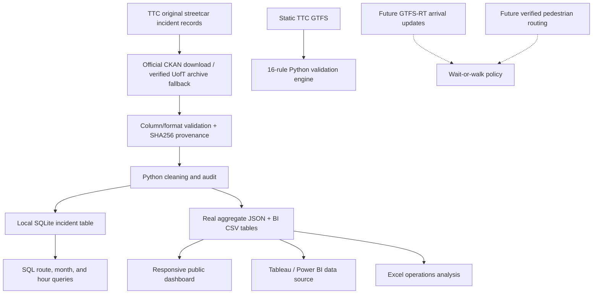

# StopStride — Real TTC Streetcar Analytics & Walk-or-Wait Research

**Python · pandas · SQLite / SQL · GTFS validation · Web analytics · BI exports · Excel/VBA · GitHub Actions**

An independent urban mobility and data engineering project using **real TTC streetcar incident records** and an explainable research prototype for a future **walk to the next stop vs wait** commuter feature.

> **Public dashboard policy: REAL DATA ONLY.** The public-facing analytics website reads only `dashboard/real_data.json` generated from verified TTC source records. It never substitutes fabricated incident figures or simulated recommendations. The walk-or-wait decision engine is code-only until we have matched, fresh predictions for actual streetcars. This is not an official TTC service.

## Current evidence from actual TTC streetcar records

The [City of Toronto's TTC Streetcar Delay Data](https://open.toronto.ca/dataset/ttc-streetcar-delay-data/) is the primary dataset. The live Open Data API returned a CSV with subway rather than streetcar fields during this development run, so the pipeline **rejected that resource** and used the [University of Toronto archival copy](https://pages.scinet.utoronto.ca/~afedosee/ttc-streetcar-delay-data-2014-2025.zip) of the actual TTC streetcar records instead.

The verified archived 2025 CSV has SHA256 `eb73f629ea3bdbca0dbdb17f1215b930dadb9ee78885b6a4c871c9fc3b1d38c3`.

| Metric | Validated 2025 records |
|---|---:|
| Date coverage | Jan 1 – Dec 10, 2025 |
| Source CSV records | 10,903 |
| Validated 2025 records | **10,744** |
| Logged incidents with positive delays | **8,377** |
| Logged incidents with zero-minute delays | **2,367** |
| Recorded service-delay minutes (sum) | **203,665** |
| Median positive-delay incident | **10 min** |
| Records excluded by current validation | **159** |

These are *incident logs*, not passenger delays, on-time percentages, or an estimate of whether walking to the next stop is safe. We do not divide incident counts by vehicle trips because the underlying incident dataset has no service-frequency denominator. Routes with more reported incidents may simply operate more service.

## Data pipeline and analytics architecture



**Current implementation:** real TTC 2025 data acquisition with provenance validation, historical incident summaries, SQLite-backed analysis, real Tableau/Power BI-ready CSV exports, public dashboard, static GTFS QA (16 rules), automated testing, and an independent wait/walk decision function.

**Not yet built or claimed:** live streetcar ETA integration, real-time trip matching, pedestrian route verification, validated rider catch outcomes, native Tableau `.twbx` or Power BI `.pbix` reports, or desktop-verified VBA macros.

## Run the REAL TTC pipeline

From the project root, after installing Python 3.11+:

```bash
python -m pip install -r requirements.txt

# Download current official City of Toronto CSV; permit archived 2025 TTC
# streetcar records ONLY if City returns an error or a mismatched schema.
python src/real_data/download_streetcar.py \
  --out outputs/real/source.csv --fallback-uoft

# Verify the downloaded file against its source SHA256, clean incidents,
# create a local SQLite table, and build the actual historical report.
python analytics/build_real_streetcar.py \
  --csv outputs/real/source.csv \
  --source-meta outputs/real/source.source.json \
  --out dashboard/real_data.json \
  --sqlite-db outputs/real/streetcar.sqlite

# Export actual TTC aggregates for Tableau/Power BI and Excel.
python analytics/export_real_tables.py \
  --json dashboard/real_data.json --out dashboard/bi

# Preview the real-data website locally.
python -m http.server 8000 --directory dashboard
```

Open `http://localhost:8000`. **There is no fake-data fallback:** if `dashboard/real_data.json` is absent or provenance validation fails, the website displays an explicit error.

You can also review the [published dashboard source](dashboard/) and [real-data build workflow](.github/workflows/real-streetcar-data.yml). The website is only published through a manually triggered GitHub Pages workflow that validates `origin = REAL` and uploads allowlisted files. It does not publish raw incident records or test fixtures.

## Reproducible SQL and BI analytics

The real streetcar pipeline can materialize `outputs/real/streetcar.sqlite`. Run `analytics/real_streetcar_queries.sql` against it to examine:
- Route-level incident counts using CTEs and `DENSE_RANK()` window functions.
- Monthly volume and share of zero-minute incidents.
- Route × hour recorded-incident distributions.
- Data coverage and distinct route labels.

The `dashboard/bi/streetcar_*.csv` tables are genuinely derived from recorded TTC incidents and have their own `SOURCE.json` provenance metadata. These are ready to import into Tableau or Power BI; **a native Tableau/Power BI workbook is not yet included**.

## GTFS data quality: existing foundation

The `src/ttc_gtfs_qa/` module retains the original 16 rule-based GTFS static-feed checks, including primary keys, required fields, referential integrity, stop order, time order and optional calendars/shapes. It produces defect reports for the feed provided locally.

```bash
python src/run_pipeline.py --data-path data/gtfs_static --output-path outputs/qa
pytest -q
```

The `examples/sample_reports` and test fixtures are for software regression and do **not** appear in real-world dashboard figures.

## Why not recommend a real walk yet?

Historical incident data cannot determine which streetcar arrives in six minutes. `src/commuteiq/decision.py` defines a deliberately conservative policy, but live WALK recommendations require, at minimum:

1. A fresh prediction for the **same trip** at the current and next stops.
2. Confirmation that the second stop is served and an accessible pedestrian path exists.
3. A walking-time estimate plus a sufficient buffer.
4. Real validation against observed arrivals and measured prediction errors.

Until those integrations and evaluations exist, **the public product does not show fake arrival times or make actionable walking recommendations**.

TTC's real-time surface feeds are documented by [Transitland](https://www.transit.land/data/feeds/f-dpz8-ttc~surface~rt); source access and same-trip matching will be checked before we add a real-time commuter view.

## Repository structure

- `src/ttc_gtfs_qa/` — original modular static GTFS QA.
- `src/real_data/download_streetcar.py` — actual historical streetcar records with source validation.
- `analytics/build_real_streetcar.py` — real TTC incident ETL and SQLite materialization.
- `analytics/real_streetcar_queries.sql` — substantive SQL queries.
- `analytics/export_real_tables.py` — Tableau/Power BI/Excel-ready real CSV tables.
- `dashboard/index.html`, `dashboard/real_app.js` — real-data public analytics UI.
- `src/commuteiq/decision.py` — future commuter recommendation algorithm.
- `excel/CommuteIQReport.bas` — historical Excel/VBA reporting prototype; desktop verification still pending.
- `tests/` — regression tests using isolated test fixtures; synthetic test inputs are not presented as observed TTC data.

## Attribution and independence

**Contains information licensed under the [Open Government Licence – Toronto](https://open.toronto.ca/open-data-license/).** The University of Toronto hosted the archived TTC 2014–2025 CSV copy referenced above. This is an independent analysis project, not sponsored or endorsed by the City of Toronto or the TTC.
