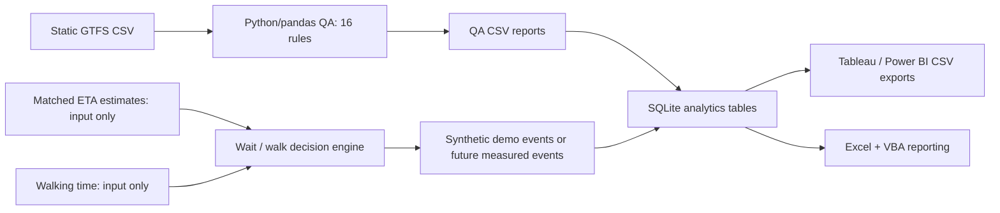

# CommuteIQ — TTC Data Quality & Wait-or-Walk Intelligence

**Python · pandas · SQL / SQLite · Tableau / Power BI-ready data · Excel VBA · pytest / GitHub Actions**

A data engineering and transit analytics portfolio project that extends a 16-rule **GTFS static feed validation pipeline** with an explainable prototype for deciding whether a streetcar rider should **wait at their current stop or walk to the next one**.

> **Status: research prototype.** The original GTFS validator works with locally supplied static feeds. The wait-or-walk engine currently accepts *provided* arrival predictions, not live TTC data. The BI demo uses clearly labelled **synthetic** examples. No rider app, live trip tracking, published Tableau/Power BI workbook or verified real-world catch-rate measurements exist yet. This is **not an official TTC product**.

## Why this project?

Transit schedules and real-time forecasts are only useful if their underlying data are reliable. A commuter who wants to get extra steps in faces a practical trade-off: **could I walk to the next streetcar stop without missing my vehicle?**

CommuteIQ explores that question through two deliberately separate layers:
1. **Data reliability:** validate GTFS schedules so downstream transit analytics do not silently rely on corrupt keys, stop sequences or calendar relationships.
2. **Decision analytics:** estimate whether a *matched* streetcar is predicted to reach the next stop after the rider, allowing a safety buffer and optionally prioritizing walking.

The long-term goal is a responsive commuter website backed by a measurable, independently evaluated decision policy.

## Architecture



**Currently implemented:** static GTFS QA, unit tests, pure Python decision function, SQLite schema, QA report importer, SQL queries, demo generator, BI CSV exporter and VBA module source.

**Not implemented:** real-time GTFS-RT adapter, trip/vehicle matching from feeds, traversable pedestrian routing, user-facing app, .twb/.pbix dashboard deliverable, completed .xlsm workbook or production monitoring.

## Try it yourself (no TTC API key, no real data needed)

Requires Python 3.11+.

```bash
git clone https://github.com/khushalr/ttc-gtfs-qa-validation.git
cd ttc-gtfs-qa-validation
python3 -m venv .venv
source .venv/bin/activate  # Windows PowerShell: .venv\Scripts\Activate.ps1
pip install -r requirements.txt
pytest -q
python src/run_analytics_demo.py
python analytics/export_dashboard.py --db outputs/demo/commuteiq.sqlite --out outputs/bi
```

The demo creates **16 synthetic QA outcomes** (3 failing) and **36 synthetic streetcar recommendation events** in a local SQLite DB. None of the synthetic events records an actual journey, completed walk or caught streetcar. The outputs in `outputs/bi/` can be imported to Tableau or Power BI and include `data_origin` labels.

The script refuses to overwrite an existing demo database; pass `--db` to choose a fresh file.

### Use your own static GTFS files

Put `routes.txt`, `trips.txt`, `stops.txt` and `stop_times.txt` in `data/gtfs_static/`. Optional files: `calendar.txt`, `calendar_dates.txt`, `shapes.txt`.

```bash
python src/run_pipeline.py --data-path data/gtfs_static --output-path outputs/qa
python analytics/load_qa_report.py --reports outputs/qa --db outputs/commuteiq.sqlite --origin LIVE --source "GTFS validation run"
python analytics/export_dashboard.py --db outputs/commuteiq.sqlite --out outputs/bi
```

Here `LIVE` means a report from **your locally supplied GTFS feed**; it does **not** indicate real-time streetcar predictions or verified rider trips. No original TTC raw datasets are stored in this repository.

The original pipeline exports `summary_report.csv`, `defect_log.csv`, and `metrics_report.csv`.

## The decision policy

The Python function `commuteiq.decision.recommend(...)` receives an ETA for **the same vehicle at the current and next stops**, estimated walking duration, feed age, and safety flags. It only suggests WALK when all of the following hold:

- The next stop is actually served by that trip, and an accessible walk is verified.
- Both ETAs have been matched to the same vehicle, and predictions are sufficiently fresh.
- The rider prefers walking, the current-stop ETA is long enough, and
  `next_stop_eta > walking_minutes + safety_buffer_minutes`.

If any verification is absent, the engine fails closed to WAIT. WALK means *plausible given the inputs*, **not guaranteed to catch the streetcar**. The default step estimate is simply walking minutes × 110 steps/min; it is not measured physical activity.

Example with explicitly verified hypothetical inputs:

```python
from commuteiq.decision import recommend

decision = recommend(
    current_eta_minutes=7,
    next_eta_minutes=11,
    walking_minutes=4,
    same_vehicle=True,
    next_stop_served=True,
    accessible_walk=True,
)
print(decision.action)        # WALK
print(decision.expected_steps)  # 440 estimated potential steps
```

Run code above with `PYTHONPATH=src python` or via a Python environment that includes `src` on its import path.

## What this demonstrates

| Skill | Evidence in the repository | Honest status |
|---|---|---|
| Python / pandas | Modular 16-rule GTFS validation, decision function, report ETL | Implemented |
| Software engineering | Tests, CI, typed model, validation, explicit fail-closed policy | Implemented; ongoing review |
| SQL | Normalized SQLite reporting tables, relational importer, analytical queries | Implemented with demo data |
| Power BI / Tableau | Reproducible CSV exports + dashboard specification | **Workbook not yet created** |
| Excel / VBA | KPI summary macro, refresh/export PDF module | **Excel integration not yet verified** |
| Real-time transit product | Planned GTFS-RT integration and mobile web application | Not implemented |

### Core project files

- `src/ttc_gtfs_qa/` — original GTFS rule engine and validators (16 rules).
- `src/commuteiq/decision.py` — deterministic walk/wait decision model.
- `src/run_analytics_demo.py` — reproducible synthetic test dataset.
- `analytics/schema.sql`, `analytics/load_qa_report.py`, `analytics/dashboard_queries.sql` — SQL analytics layer.
- `analytics/export_dashboard.py` — Tableau/Power BI CSV exports.
- `excel/CommuteIQReport.bas` — importable VBA module.
- `tests/` and `.github/workflows/ci.yml` — automated validation.
- [Analytics guide](analytics/README.md) — data dictionary, design decisions and dashboard build plan.
- [Product roadmap](docs/ROADMAP.md) — live data, geospatial routing and user-facing app.

## Design limitations and measurement integrity

- A recommendation event is **not** proof that a rider walked, caught the vehicle or avoided a delay.
- The SQL schema keeps independently observed `caught_vehicle` outcomes NULL in the synthetic demo; these are never imputed.
- QA rule violations may overlap across records, so summed affected-row counts should not be called distinct invalid records.
- Static GTFS supplies planned timetables and route patterns, **not real-time arrival forecasts**.
- Real-world feasibility requires comparing the prediction error of matched consecutive-stop arrivals, geospatial walking time and mobility preferences.
- The application will need a review of the official data providers' licensing, API coverage and usage requirements before deployment.

## Next steps

1. Connect the QA CSV producer to SQLite in a versioned, automated flow.
2. Build and publish a **real Tableau or Power BI dashboard workbook** with sanitized data and screenshots.
3. Validate a working Excel `.xlsm` workbook and the VBA refresh/export macro.
4. Implement live streetcar ETA ingestion with same-trip matching and pedestrian travel-time estimates.
5. Evaluate conservative WALK/WAIT recommendations against observed transit arrivals before deploying a consumer app.

---

Built as an independent software and analytics portfolio project. TTC is a trademark of its respective owner; no affiliation or endorsement is implied. Demo data and examples are synthetic.
