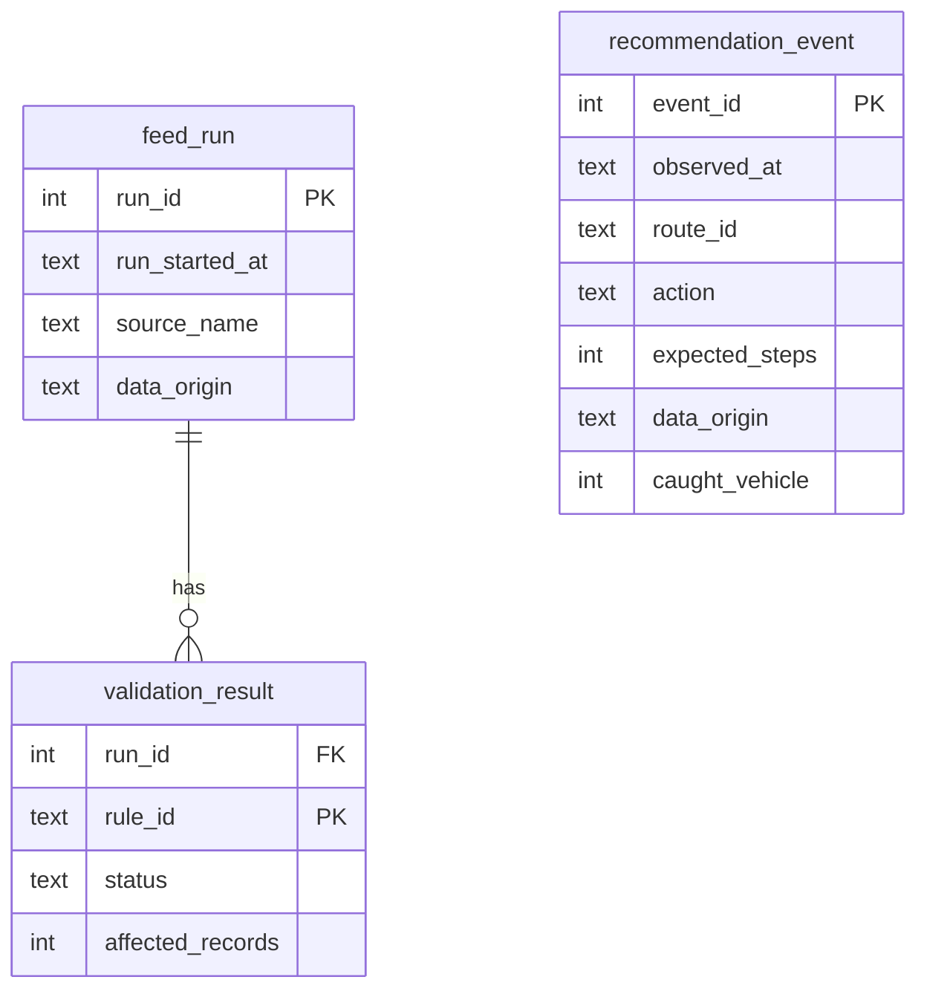

# CommuteIQ analytics: data dictionary and dashboard specification

This module adds a SQLite reporting layer to the repository's existing Python GTFS validation system. Its starter dataset is **synthetic**, not evidence of real rider behaviour.

## Reproduce the complete demo

Run these commands from the repository root:

```bash
pip install -r requirements.txt
pytest -q
python src/run_analytics_demo.py
python analytics/export_dashboard.py --db outputs/demo/commuteiq.sqlite --out outputs/bi
```

The demo refuses to overwrite `outputs/demo/commuteiq.sqlite`; choose a new path with `--db` for additional runs.

Expected deterministic counts: **16 QA rules (3 failing)** and **36 synthetic streetcar recommendations**. The demo records no actual journeys, no real arrivals, and no observed catches.

## Ingest outputs from the original GTFS QA pipeline

```bash
python src/run_pipeline.py --data-path data/gtfs_static --output-path outputs/qa
python analytics/load_qa_report.py --reports outputs/qa --db outputs/commuteiq.sqlite --origin LIVE --source 'GTFS static data validation'
python analytics/export_dashboard.py --db outputs/commuteiq.sqlite --out outputs/bi
```

`--origin LIVE` means the QA report came from your actual locally supplied static GTFS feed. It does **not** mean the commuter decision system has received real-time arrival predictions. Do not use `LIVE` with the bundled synthetic example files.

## Relational model



`recommendation_event` is independent of `feed_run` at this stage. A future live collector should establish feed-version/provenance relationships before attributing recommendations to a particular feed.

## Key fields and measurement rules

| Field | Meaning | Important limitation |
|---|---|---|
| `feed_run.data_origin` | `DEMO` or `LIVE` provenance | `LIVE` refers to the QA source, not necessarily live predictions |
| `validation_result.status` | PASS / FAIL / SKIP result for an individual rule | Not an overall grade of transit operations |
| `recommendation_event.action` | Algorithm suggested WALK or WAIT | Not proof that the rider followed it |
| `walking_minutes` | Estimated pedestrian travel time | Real product must use traversable paths, not straight-line geometry |
| `expected_steps` | Approximate steps from walking duration | Potential steps, not activity-tracker measurements |
| `caught_vehicle` | Independently established matching vehicle catch | NULL when no observation is available |
| `arrival_observed` | Indicates observation is available | Demo always 0 |

Do not divide the number of WALK recommendations by all events and call it "walk adoption." Do not treat unknown catch outcomes as failures or successes.

## Tableau / Power BI dashboard storyboard

**Dashboard 1: Data Trust**
- KPI cards: QA rules checked, failed rules, affected rows, feed-run history.
- Table: `validation_result`, filtered by `feed_run.run_id`; severity filter and tooltip with rule ID.
- Caveat: rules are overlapping, so `SUM(affected_records)` is rule violations, not distinct faulty records.

**Dashboard 2: Rider Decision Intelligence**
- Stacked bars: count of WALK vs WAIT by route and hour.
- KPI: fraction of events recommended WALK (recommendation mix only).
- Distribution: walking minutes by action; potential steps vs route.
- Filter by `data_origin`; demo watermark if any synthetic records are included.

**Dashboard 3: Evaluation & Safety (future live measurements)**
- Real outcome coverage, matched-trip accuracy and catch rates **only** when independently observed.
- Feed age and rejection reason distributions.
- Calibration plots of next-stop ETA predictions and their eventual observed arrivals.

### Connecting CSVs
1. Run `analytics/export_dashboard.py` after creating the demo SQLite file.
2. Import `feed_run.csv`, `validation_result.csv`, and `recommendation_event.csv`.
3. Relate `validation_result.run_id` to `feed_run.run_id`. Keep `recommendation_event` separate; there is no valid key joining it to `feed_run` yet.
4. Show `data_origin` prominently and never mix synthetic and live records without a filter.
5. Once built and manually checked, commit a Tableau `.twb` or a Power BI `.pbix` plus sanitized screenshots into a separate `dashboards/` folder.

No `.twb` / `.pbix` workbook is supplied in this milestone.

### Reusable SQLite SQL
Three example analysis queries live in `analytics/dashboard_queries.sql`. They have been designed to run against the exported schema; integration tests execute them against the demo database.

## Excel and VBA

Import the CSVs into Excel, create an empty sheet named `Dashboard`, save as `.xlsm`, then import `excel/CommuteIQReport.bas` in the Visual Basic Editor. `BuildOperationsSummary` computes QA and decision metrics; `RefreshAndExportDashboard` refreshes sources and exports a PDF.

Excel desktop versions vary in how they run refresh connections, especially on macOS. The macro has **not yet been verified in desktop Excel**, and asynchronous data connections must finish refreshing before the export can be relied on.

## Next milestones to truthfully claim on a resume

- Ship and test an actual Tableau/Power BI dashboard workbook, not only CSV outputs.
- Verify VBA on a real `.xlsm` workbook and show a short GIF/screenshot.
- Add GTFS-RT ingestion with real trip identity matching and physical walking routes.
- Collect anonymized evaluation data to measure decision quality against a baseline.
